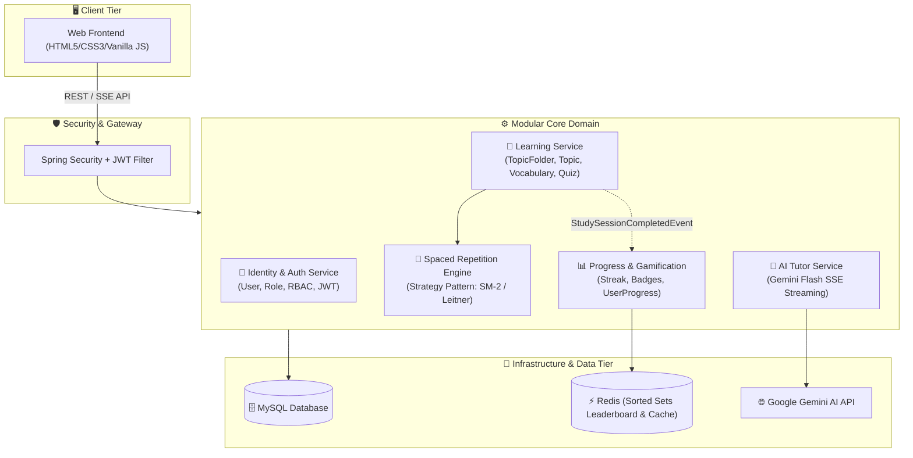

# 📚 English Smart Learning Platform

<p align="center">
  
  
  
  
  
  
</p>

---

## 🌟 Giới thiệu tổng quan (Overview)

**English Smart Learning Platform** là nền tảng học từ vựng và luyện tập tiếng Anh thông minh được xây dựng theo chuẩn **Kiến trúc hướng Module (Modular Monolith)**. Hệ thống kết hợp thuật toán lặp lại ngắt quãng (**Spaced Repetition System - SM-2**), cơ chế Caching & Leaderboard siêu tốc với **Redis**, cùng trợ lý gia sư ảo **Gemini AI Streaming (SSE)** giúp cá nhân hóa lộ trình ghi nhớ từ vựng cho người học.

Dự án được thiết kế không chỉ để giải quyết bài toán nghiệp vụ học tập thực tế mà còn là mô hình mẫu chuẩn chỉ phục vụ cho việc nghiên cứu môn **Kiến trúc & Thiết kế phần mềm**, áp dụng thực chiến các **Design Patterns** kinh điển và sẵn sàng mở rộng quy mô.

---

## 🏗️ Kiến trúc hệ thống (System Architecture)

Hệ thống được tổ chức theo mô hình **Modular Monolith** kết hợp nguyên lý **Domain-Driven Design (DDD)** và luồng **Event-Driven bất đồng bộ**:



---

## 🎯 Các Design Patterns áp dụng trong dự án

Dự án chú trọng tính bền vững và khả năng mở rộng của mã nguồn thông qua việc áp dụng chuẩn xác các mẫu thiết kế:

| Design Pattern | Vị trí áp dụng | Mục đích kiến trúc |
| :--- | :--- | :--- |
| **Strategy Pattern** | Thuật toán ôn tập Spaced Repetition (`SM-2`, `Leitner`) & Chế độ học (`Flashcard`, `Quiz`, `Dictation`) | Tuân thủ nguyên lý **Open/Closed Principle (OCP)**. Cho phép dễ dàng bổ sung thuật toán tính khoảng cách ôn tập mới mà không cần sửa code nghiệp vụ cốt lõi. |
| **Factory Pattern** | Khởi tạo câu hỏi tự động (`QuizQuestionFactory`) | Linh hoạt tạo các loại câu hỏi trắc nghiệm, điền từ, nghe chính tả từ dữ liệu từ vựng thô, loại bỏ hoàn toàn các chuỗi `switch-case` phức tạp. |
| **Observer Pattern** | Xử lý Gamification & Sự kiện hoàn thành bài học | Đảm bảo **Loose Coupling**. Khi người dùng học xong, `LearningService` phát sự kiện qua Spring `ApplicationEventPublisher`. Các listener tự động lắng nghe để cập nhật Streak, mở khóa Badge và gửi thông báo. |

---

## ⚡ Tính năng nổi bật & Chiều sâu kỹ thuật

### 1. 🧠 Thuật toán Spaced Repetition (SRS - SM-2)
- Thay vì ôn tập ngẫu nhiên, hệ thống dựa vào phản hồi độ khó của người học (*Quên / Khó / Tốt / Dễ*) để tự động tính toán hệ số ghi nhớ (**Ease Factor**) và khoảng cách ngày ôn tập tiếp theo (**Interval Days**).
- Tự động lọc danh sách thẻ "đến hạn ôn tập hôm nay" giúp tối ưu hóa thời gian học.

### 2. ⚡ Hiệu năng cao với Redis
- **Leaderboard thời gian thực:** Ứng dụng cấu trúc **Redis Sorted Set (`ZSET`)** với các thao tác `ZINCRBY` và `ZREVRANGE` đạt độ phức tạp $O(\log N)$, giải quyết triệt để bài toán thắt nút cổ chai khi xếp hạng người dùng trên bảng triệu dòng của SQL.
- **Cache-Aside Pattern:** Cache các bộ từ vựng công khai (Public Topics/Decks) có lượt truy cập cao, giảm tải trực tiếp cho MySQL.

### 3. 🤖 Gia sư ảo AI tích hợp (Gemini AI Streaming)
- Tích hợp mô hình Gemini AI qua cơ chế **Server-Sent Events (SSE)**, phản hồi câu trả lời theo thời gian thực (real-time stream).
- Hỗ trợ giải thích ngữ pháp, từ đồng nghĩa/trái nghĩa và đặt câu ví dụ trong ngữ cảnh thực tế.

### 4. 🔒 Kiến trúc bảo mật đa lớp
- Xác thực Stateless qua **JWT (JSON Web Token)**.
- Quản lý cấu hình bí mật (**Externalized Secret Management**) ngăn chặn hoàn toàn rò rỉ API Key khi làm việc nhóm và đẩy code lên Git.

---

## 🛠️ Công nghệ sử dụng (Tech Stack)

- **Backend:** Java 21, Spring Boot 3.3.0
- **Security:** Spring Security, JJWT (io.jsonwebtoken 0.11.5)
- **Database:** MySQL 8.0, Spring Data JPA, Hibernate
- **Caching & Ranking:** Redis (Spring Data Redis, Jedis/Lettuce)
- **AI Integration:** Google Gemini REST API (SSE Streaming)
- **Build Tool:** Maven (mvnw)
- **Frontend:** HTML5, CSS3, JavaScript (Vanilla ES6+), Responsive UI

---

## 🚀 Hướng dẫn cài đặt và chạy ứng dụng (Getting Started)

### 1. Yêu cầu môi trường (Prerequisites)
- **JDK:** Java 21 trở lên
- **Database:** MySQL 8.x
- *(Tùy chọn)* **Redis Server** hoặc Docker

### 2. Cấu hình cơ sở dữ liệu
Tạo database MySQL:
```sql
CREATE DATABASE english_db CHARACTER SET utf8mb4 COLLATE utf8mb4_unicode_ci;
```

Cập nhật thông tin kết nối trong file `src/main/resources/application.properties`:
```properties
spring.datasource.url=jdbc:mysql://localhost:3306/english_db?useSSL=false&allowPublicKeyRetrieval=true&serverTimezone=Asia/Ho_Chi_Minh
spring.datasource.username=root
spring.datasource.password=your_mysql_password
```

### 3. Cấu hình Gemini API Key
Tạo file `src/main/resources/application-secret.properties` (file này đã được `.gitignore` bảo vệ):
```properties
gemini.api.key=YOUR_GEMINI_API_KEY
```

### 4. Khởi chạy ứng dụng
**Cách 1: Chạy bằng Maven Wrapper**
```bash
# Windows
.\mvnw.cmd spring-boot:run

# Linux / MacOS
./mvnw spring-boot:run
```

**Cách 2: Chạy trực tiếp qua file script tiện ích (Windows)**
Nhấp đúp chuột vào file `run.bat` tại thư mục gốc.

Truy cập hệ thống tại: **`http://localhost:8082`**

---

## 🗺️ Lộ trình phát triển (Roadmap)

- [x] Khởi tạo kiến trúc nền tảng Spring Boot 3.3 & JWT Security.
- [x] Xây dựng CRUD Quản lý Từ vựng (Vocabulary), Chủ đề (Topic), Bài kiểm tra (Quiz).
- [x] Tích hợp Gemini AI SSE Chatbot.
- [ ] Hoàn thiện Strategy Pattern cho thuật toán SM-2 SRS.
- [ ] Triển khai Bảng xếp hạng tuần/tháng với Redis Sorted Set.
- [ ] Tính năng Import/Export hàng nghìn từ vựng qua file Excel bất đồng bộ (Apache POI + Background Worker).
- [ ] Chấm điểm ngữ pháp câu do người học tự đặt với AI (Contextual AI Evaluation).

---

## 👨‍💻 Tác giả (Author)

- **GitHub:** [@davidanh554](https://github.com/davidanh554)
- **Dự án:** [english-learning-app](https://github.com/davidanh554/english-learning-app)
